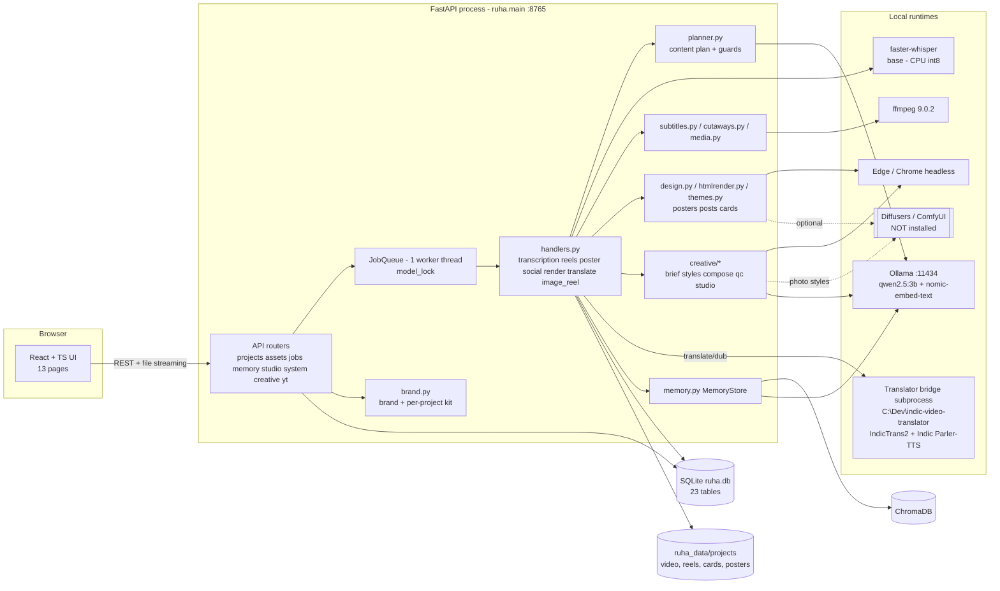

# RUHA — Architecture

Inspection only. Facts below were read from code, the SQLite file (opened read-only), the file system and system probes.

## 1. Actual architecture (not assumed)

El Ruach Manager is a **local-first single-machine web app**:

- **Backend:** Python 3.13 (main venv), **FastAPI** + Uvicorn, SQLAlchemy 2.0 on **SQLite** (`ruha_data/ruha.db`, WAL mode). Entry point `python -m ruha.main` (`ruha/main.py`), default `127.0.0.1:8765`.
- **Frontend:** **React 18 + TypeScript + Vite + Tailwind** (`frontend/`). Built output `frontend/dist` is served by the backend; 13 pages (Dashboard, Projects, ProjectDetail, Library, Review, Calendar, Analytics, Memory, Processing, Brand, Settings, Creative, YtVideo).
- **Job system:** one sequential worker thread (`ruha/jobs.py` `JobQueue`), jobs persisted in `processing_jobs`, a re-entrant `model_lock` so only one heavy model is in memory at a time.
- **AI runtimes:**
  - faster-whisper (in the main venv) for transcription.
  - **Ollama** (HTTP, `localhost:11434`) for the LLM (`qwen2.5:3b`) and embeddings (`nomic-embed-text`).
  - **Translator bridge**: a *second* Python environment at `C:\Dev\indic-video-translator` (Python 3.12, its own torch/transformers/gradio) invoked as a subprocess by `ruha/ai/translator.py` → `translator_worker.py` → `app._translate_impl` (Whisper + IndicTrans2 + Indic Parler-TTS). The JSON-lines protocol uses the `@@RUHA@@` marker.
  - Image generation back-ends (diffusers / ComfyUI) — **code present, nothing installed**.
- **Media:** ffmpeg 9.0.2 (WinGet install) for cut, crop, subtitles (ASS), cards, cutaways, concat, loudness. NVENC used only when present.
- **Graphics:** headless Edge/Chrome screenshots of HTML/CSS (primary) + Pillow (fallback and backgrounds).
- **Memory:** ChromaDB (`ruha_data/chroma`) with Ollama embeddings or a hashing fallback.
- **Storage:** everything under `ruha_data/` (DB, `projects/<id>-<slug>/…`, `brand/`, `chroma/`, `logs/`, `backups/`, `yt/`).

### Legacy code still in the repo
A previous **Streamlit MVP** lives in top-level `app/`, `services/`, `database/`, `agents/`, `storage/`, root `main.py`, `requirements-legacy.txt`, and a static root `index.html`. The new app does not import them (`docs/LEGACY_STREAMLIT_MVP.md` documents this).

## 2. Mermaid diagram

## 3. Component communication

| From → To | How |
|---|---|
| UI → backend | `fetch` REST under `/api/…`; media via `FileResponse` (range requests) |
| API → jobs | `JobQueue.enqueue(job_type, project_id, params)`; DB row `processing_jobs` |
| Worker → handlers | `ruha/handlers.py` functions registered per `JOB_TYPES` |
| Handlers → LLM | HTTP POST `http://localhost:11434/api/generate` |
| Handlers → Whisper | in-process `faster_whisper.WhisperModel`, loaded per job then freed |
| Handlers → translator | `subprocess.Popen(translator_python -I translator_worker.py)`; JSON lines on stdout |
| Handlers → ffmpeg | `subprocess` via `media.run` |
| Handlers → graphics | HTML string → `msedge --headless=new --screenshot` → PNG |
| Everything → DB | SQLAlchemy sessions (`app.db.session()`); schema via `schema_migrations` |
| Memory | `MemoryStore` ↔ Chroma + Ollama embeddings; plan prompts read `prompt_context` |

## 4. Reusable components for extension

- Job queue, `model_lock`, resource checks (`check_free_ram`, `hardware.check_resources`).
- `planner.py` guards (scripture validation, clip snapping, one-word hooks).
- `creative/` pipeline (brief → picture → compose → QC) — already model-agnostic; only needs a back-end.
- `htmlrender.py` font/CSS system and its transparent-layer renderer in `creative/compose.py`.
- `subtitles.py` (stacked Poppins captions), `cutaways.py`, `media.render_reel`.
- `brand.py` per-project kit (logo + text templates).
- Memory store and `asset_versions` history for approvals/rollbacks.
- Translator bridge (isolated environment keeps the manager lightweight).
